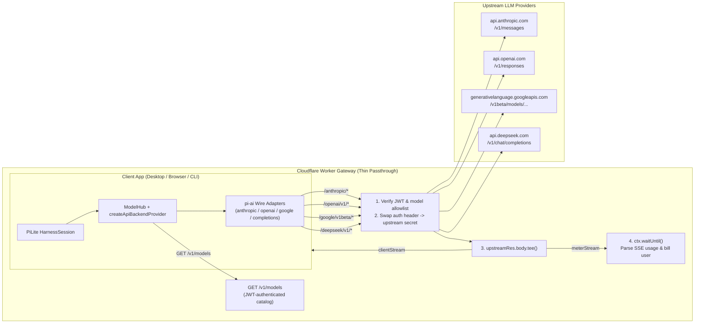

# Cloudflare Workers Multi-Protocol Passthrough Gateway Example

> Related source: [src/models/backend.ts](../src/models/backend.ts), [src/models/api-streams.ts](../src/models/api-streams.ts), and [docs/models-and-extensions.md](models-and-extensions.md).

This guide shows how to connect **PiLite** (`createApiBackendProvider` + `createModelHub`) to a self-hosted, JWT-authenticated, **multi-protocol passthrough LLM gateway** using **Cloudflare Workers** as a concrete end-to-end example.

You can adapt the exact same contract to any edge or backend proxy (Nginx/OpenResty, Fastify, Hono, Go, Rust, etc.).

---

## 1. Architecture Overview

**Key principle: `pi-ai` runs on the client (inside PiLite), NOT inside the Cloudflare Worker.**

- **Client (`PiLite` + `pi-ai`)**: Fetches the model catalog from your gateway (`GET /v1/models`), selects the exact `pi-ai` wire adapter (`anthropic-messages`, `openai-responses`, `google-generative-ai`, or `openai-completions`) based on each model's `api` field, formats prompts/tools/thinking/caching natively, sends the request to that model's `baseUrl`, and normalizes the upstream SSE stream into PiLite events.
- **Cloudflare Worker (thin passthrough proxy)**: Needs **zero LLM SDKs** and **zero protocol translation**. It verifies your user's JWT, enforces model allowlists and quota limits, swaps client auth headers for upstream provider secrets, streams the upstream response straight back to the client via `ReadableStream.tee()`, and extracts token usage asynchronously in `ctx.waitUntil()` for authoritative billing.



---

## 2. Routing & Auth Contract

### Protocol Routing by Path Prefix

Because every model returned by `GET /v1/models` carries its own `api` and `baseUrl`, the Worker knows **which upstream provider and usage schema to apply solely from the URL prefix**:

| Gateway Prefix | `model.api` (in `/v1/models`) | Upstream Origin + Path Rewrite | Upstream Auth Header | Usage Format |
| --- | --- | --- | --- | --- |
| `/anthropic/*` | `anthropic-messages` | `https://api.anthropic.com/*` (e.g. `/v1/messages`) | `x-api-key: <ANTHROPIC_API_KEY>` | Split across `message_start` + `message_delta` |
| `/openai/v1/*` | `openai-responses` or `openai-completions` | `https://api.openai.com/v1/*` | `authorization: Bearer <OPENAI_API_KEY>` | `response.completed` or final chunk `usage` |
| `/google/v1beta/*` | `google-generative-ai` | `https://generativelanguage.googleapis.com/v1beta/*` | `x-goog-api-key: <GEMINI_API_KEY>` | Final chunk `usageMetadata` |
| `/deepseek/v1/*` | `openai-completions` | `https://api.deepseek.com/v1/*` | `authorization: Bearer <DEEPSEEK_API_KEY>` | Final chunk `usage` (requires `stream_options.include_usage`) |

### Unified Client Auth Header

Different `pi-ai` wire adapters place `auth.apiKey` into different headers by default:
- `openai-completions` / `openai-responses` → `Authorization: Bearer <apiKey>`
- `anthropic-messages` → `x-api-key: <apiKey>`
- `google-generative-ai` → `x-goog-api-key: <apiKey>`

To keep gateway auth uniform across every protocol (and `GET /v1/models`), return **both** `apiKey` (so `pi-ai` considers the provider authenticated) and a dedicated header such as `x-gateway-token` from `getAuth()`. The Worker reads `x-gateway-token` first (falling back to the native headers if needed), verifies the JWT, and **strips all client auth headers** before forwarding upstream.

---

## 3. Gateway Model Catalog (`GET /v1/models`)

PiLite's default parser `parseOpenAICompatibleModels()` accepts `{ data: [...] }`, `{ models: [...] }`, or a top-level JSON array, and forwards all standard `pi-ai` model metadata fields.

### Example `GET /v1/models` Response

```json
{
  "object": "list",
  "data": [
    {
      "id": "claude-sonnet-4-5",
      "name": "Claude Sonnet 4.5",
      "api": "anthropic-messages",
      "baseUrl": "https://gw.example.com/anthropic",
      "reasoning": true,
      "input": ["text", "image"],
      "contextWindow": 200000,
      "maxTokens": 64000,
      "cost": {
        "input": 3,
        "output": 15,
        "cacheRead": 0.3,
        "cacheWrite": 3.75
      },
      "promptCache": { "short": 300, "long": 3600 },
      "inputLimits": {
        "images": { "maxPerRequest": 100 }
      }
    },
    {
      "id": "gpt-5.4",
      "name": "GPT-5.4",
      "api": "openai-responses",
      "baseUrl": "https://gw.example.com/openai/v1",
      "reasoning": true,
      "input": ["text", "image"],
      "contextWindow": 400000,
      "maxTokens": 128000,
      "cost": {
        "input": 2.5,
        "output": 15,
        "cacheRead": 0.25,
        "cacheWrite": 0,
        "tiers": [
          {
            "inputTokensAbove": 272000,
            "input": 5,
            "output": 22.5,
            "cacheRead": 0.5,
            "cacheWrite": 0
          }
        ]
      },
      "thinkingLevelMap": {
        "xhigh": "xhigh",
        "max": null
      }
    },
    {
      "id": "gemini-2.5-pro",
      "name": "Gemini 2.5 Pro",
      "api": "google-generative-ai",
      "baseUrl": "https://gw.example.com/google/v1beta",
      "reasoning": true,
      "input": ["text", "image"],
      "contextWindow": 1048576,
      "maxTokens": 65536,
      "cost": {
        "input": 1.25,
        "output": 10,
        "cacheRead": 0.31,
        "cacheWrite": 0
      }
    },
    {
      "id": "deepseek-reasoner",
      "name": "DeepSeek Reasoner",
      "api": "openai-completions",
      "baseUrl": "https://gw.example.com/deepseek/v1",
      "reasoning": true,
      "input": ["text"],
      "contextWindow": 128000,
      "maxTokens": 32768,
      "cost": {
        "input": 0.55,
        "output": 2.19,
        "cacheRead": 0.14,
        "cacheWrite": 0
      },
      "compat": {
        "thinkingFormat": "deepseek",
        "supportsStore": false,
        "supportsDeveloperRole": false,
        "supportsUsageInStreaming": true
      }
    }
  ]
}
```

### Supported Catalog Fields (`parseOpenAICompatibleModels`)

| Field | Required | Purpose in PiLite / `pi-ai` |
| --- | --- | --- |
| `id` | **Yes** | Model ID sent to upstream and persisted in `ModelRef` |
| `api` | Recommended | Wire protocol (`anthropic-messages`, `openai-responses`, `google-generative-ai`, `openai-completions`). Defaults to `defaultApi` (`"openai-completions"`). |
| `baseUrl` | Recommended | Per-model gateway prefix URL. Defaults to provider `baseUrl`. |
| `name` | Optional | Human-readable label (defaults to `id`). |
| `reasoning` | Recommended | Enables thinking/reasoning parameters and UI levels (default: `false`). |
| `input` | Recommended | Supported modalities: `["text"]` or `["text", "image"]` (default: `["text"]`). |
| `contextWindow` | Recommended | Context limit in tokens — drives auto-compaction thresholds and `ctx.getContextUsage()` (also accepts `context_length` / `max_model_len`; default: `128_000`). |
| `maxTokens` | Recommended | Max output tokens per turn (also accepts `max_completion_tokens` / `max_output_tokens`; default: `16_384`). |
| `cost` | Optional | USD per 1M tokens (`input`, `output`, `cacheRead`, `cacheWrite`, optional `tiers[]`) for client-side cost estimates. |
| `compat` | Optional | Per-API compatibility quirks (e.g., `thinkingFormat: "deepseek"`, `supportsStore: false`, `maxTokensField`). Shallow-merged over `modelDefaults.compat`. |
| `thinkingLevelMap` | Optional | Maps Pi thinking levels (`off`..`max`) to provider values or `null` to mark a level unsupported (`session.getAvailableThinkingLevels()`). |
| `headers` | Optional | Extra per-model static string headers sent on inference requests. |
| `promptCache` | Optional | Prompt cache TTLs in seconds (`{ short?: number; long?: number }`). |
| `inputLimits` | Optional | Request byte and image preprocessing limits (`{ maxRequestBytes?, images?: { maxPerMessage?, maxPerRequest?, resize? } }`). |
| `samplingParams` / `samplingParamsByThinkingLevel` | Optional | Default sampling parameters for OpenAI-compatible adapters. |

---

## 4. Client Integration (PiLite)

`createApiBackendProvider()` lazy-registers all four standard chat wire APIs by default (`openai-completions`, `openai-responses`, `anthropic-messages`, `google-generative-ai`) and preserves each model's `baseUrl` unless `getAuth()` explicitly returns an override `baseUrl`.

```ts
import { createSession, InMemorySessionStore } from "pilite";
import { createApiBackendProvider, createModelHub } from "pilite/models";
// Optional offline catalog caching:
// - Node/Bun: import { createSqliteModelsStore } from "pilite/models/sqlite";
// - Browser:  import { openIndexedDbModelStores } from "pilite/models/indexeddb";

// 1. Maintain a cached short-lived JWT with proactive refresh.
interface TokenState {
  token: string;
  expiresAtMs: number;
}
let tokenState: TokenState | null = null;
let inFlightRefresh: Promise<string> | null = null;

async function getValidJwt(signal?: AbortSignal): Promise<string> {
  const now = Date.now();
  // Refresh 60 seconds before expiry to avoid mid-request 401s.
  if (tokenState && tokenState.expiresAtMs - now > 60_000) {
    return tokenState.token;
  }
  if (!inFlightRefresh) {
    inFlightRefresh = (async () => {
      const res = await fetch("https://auth.example.com/token/refresh", {
        method: "POST",
        credentials: "include",
        signal,
      });
      if (!res.ok) throw new Error(`JWT refresh failed: HTTP ${res.status}`);
      const data = (await res.json()) as { accessToken: string; expiresInSeconds: number };
      tokenState = {
        token: data.accessToken,
        expiresAtMs: Date.now() + data.expiresInSeconds * 1000,
      };
      return tokenState.token;
    })().finally(() => {
      inFlightRefresh = null;
    });
  }
  return inFlightRefresh;
}

// 2. Define the multi-protocol gateway provider.
const cfGateway = createApiBackendProvider({
  id: "my-gateway",
  name: "My Cloudflare Gateway",
  // Base URL for GET /v1/models (and default fallback if a model omits baseUrl).
  baseUrl: "https://gw.example.com/v1",
  modelsEndpoint: "/models",
  getAuth: async ({ signal }) => {
    const jwt = await getValidJwt(signal);
    return {
      // apiKey satisfies pi-ai auth checks; x-gateway-token gives the Worker one uniform header.
      // Do NOT return `baseUrl` here unless you want to override every per-model `baseUrl`.
      apiKey: jwt,
      headers: { "x-gateway-token": jwt },
      source: "gateway-jwt",
    };
  },
});

// 3. Assemble ModelHub (add `modelsStore` for instant offline startup).
const hub = createModelHub({
  providers: [cfGateway],
  // modelsStore: createSqliteModelsStore(db), // or IndexedDbModelsStore in browser
});

// Fast startup: restore cached catalog if available, then refresh from GET /v1/models.
await hub.init({ allowNetwork: false });
const refreshed = await hub.refresh({ allowNetwork: true });
if (refreshed.errors.size > 0) {
  console.warn("Catalog refresh warnings:", refreshed.errors);
}

// 4. Create a PiLite session using the hot-swappable ModelsProvider.
const session = await createSession({
  models: hub.asModelsProvider(),
  store: new InMemorySessionStore(),
  model: { provider: "my-gateway", modelId: "claude-sonnet-4-5" },
  systemPrompt: "You are a helpful assistant.",
  // UI display only — NEVER use client-side usage events for billing!
  onUsage: (event) => {
    console.log("Client-side usage estimate:", event.modelId, event.usage.totalTokens);
  },
});

// Turn 1: routes to https://gw.example.com/anthropic/v1/messages (anthropic-messages)
await session.prompt("Summarize the pros and cons of edge proxies in 3 bullets.");

// Turn 2: switch seamlessly to OpenAI Responses API -> https://gw.example.com/openai/v1/responses
await session.setModel({ provider: "my-gateway", modelId: "gpt-5.4" });
await session.prompt("Now write a concise TypeScript interface for that.");

// Turn 3: switch seamlessly to Gemini -> https://gw.example.com/google/v1beta/models/gemini-2.5-pro:streamGenerateContent
await session.setModel({ provider: "my-gateway", modelId: "gemini-2.5-pro" });
await session.prompt("Review the interface for edge cases.");
```

### Optional: Reusing Gateway Auth for Embeddings

If your gateway also exposes `POST /openai/v1/embeddings`, PiLite's `EmbeddingProvider` reuses the exact same `getAuth()` JWT automatically:

```ts
hub.registerEmbeddingModels([
  {
    id: "text-embedding-3-small",
    name: "OpenAI Embedding 3 Small",
    provider: "my-gateway",
    baseUrl: "https://gw.example.com/openai/v1",
    dimensions: 1536,
  },
]);

const embedder = hub.createEmbeddingProvider("my-gateway", "text-embedding-3-small");
const { embeddings } = await embedder.embed(["hello world"]);
```

---

## 5. Cloudflare Worker Implementation

### `wrangler.toml`

```toml
name = "pilite-llm-gateway"
main = "src/worker.ts"
compatibility_date = "2026-01-01"

[vars]
ALLOWED_ORIGIN = "https://app.example.com" # or "*" for native desktop apps
JWT_ISSUER = "https://auth.example.com"
JWT_AUDIENCE = "pilite-gateway"

# Optional bindings for quota / usage persistence:
# [[kv_namespaces]]
# binding = "USAGE_KV"
# id = "..."
#
# [[d1_databases]]
# binding = "BILLING_DB"
# database_name = "billing"
# database_id = "..."
```

Store upstream API keys and JWT signing material as **Cloudflare Secrets** (never in `wrangler.toml`):

```bash
wrangler secret put JWT_HS256_SECRET
wrangler secret put ANTHROPIC_API_KEY
wrangler secret put OPENAI_API_KEY
wrangler secret put GEMINI_API_KEY
wrangler secret put DEEPSEEK_API_KEY
```

### `src/worker.ts` (Complete Zero-SDK Passthrough + Multi-Protocol Usage Metering)

```ts
export interface Env {
  ALLOWED_ORIGIN: string;
  JWT_ISSUER: string;
  JWT_AUDIENCE: string;
  JWT_HS256_SECRET: string;
  ANTHROPIC_API_KEY: string;
  OPENAI_API_KEY: string;
  GEMINI_API_KEY: string;
  DEEPSEEK_API_KEY: string;
}

type WireApi =
  | "anthropic-messages"
  | "openai-responses"
  | "openai-completions"
  | "google-generative-ai";

interface GatewayModelEntry {
  id: string;
  name: string;
  api: WireApi;
  routePrefix: string; // e.g. "/anthropic"
  reasoning: boolean;
  input: ("text" | "image")[];
  contextWindow: number;
  maxTokens: number;
  cost: {
    input: number;
    output: number;
    cacheRead: number;
    cacheWrite: number;
  };
  compat?: Record<string, unknown>;
  thinkingLevelMap?: Record<string, string | null>;
  promptCache?: { short?: number; long?: number };
}

interface RouteConfig {
  prefix: string;
  upstreamOrigin: string;
  /** Default wire API for usage parsing on this route. */
  defaultApi: WireApi;
  injectUpstreamAuth: (headers: Headers, env: Env) => void;
}

interface NormalizedUsage {
  /** Non-cached input tokens (matching pi-ai's `Usage.input` semantics). */
  input: number;
  /** Output tokens, including reasoning/thinking tokens. */
  output: number;
  cacheRead: number;
  cacheWrite: number;
  reasoning?: number;
  totalTokens: number;
}

interface JwtClaims {
  sub: string;
  exp: number;
  iss?: string;
  aud?: string | string[];
  tier?: string;
}

// ---------------------------------------------------------------------------
// 1. Model Catalog & Route Table
// ---------------------------------------------------------------------------

const CATALOG: readonly GatewayModelEntry[] = [
  {
    id: "claude-sonnet-4-5",
    name: "Claude Sonnet 4.5",
    api: "anthropic-messages",
    routePrefix: "/anthropic",
    reasoning: true,
    input: ["text", "image"],
    contextWindow: 200_000,
    maxTokens: 64_000,
    cost: { input: 3, output: 15, cacheRead: 0.3, cacheWrite: 3.75 },
    promptCache: { short: 300, long: 3600 },
  },
  {
    id: "gpt-5.4",
    name: "GPT-5.4",
    api: "openai-responses",
    routePrefix: "/openai/v1",
    reasoning: true,
    input: ["text", "image"],
    contextWindow: 400_000,
    maxTokens: 128_000,
    cost: { input: 2.5, output: 15, cacheRead: 0.25, cacheWrite: 0 },
  },
  {
    id: "gemini-2.5-pro",
    name: "Gemini 2.5 Pro",
    api: "google-generative-ai",
    routePrefix: "/google/v1beta",
    reasoning: true,
    input: ["text", "image"],
    contextWindow: 1_048_576,
    maxTokens: 65_536,
    cost: { input: 1.25, output: 10, cacheRead: 0.31, cacheWrite: 0 },
  },
  {
    id: "deepseek-reasoner",
    name: "DeepSeek Reasoner",
    api: "openai-completions",
    routePrefix: "/deepseek/v1",
    reasoning: true,
    input: ["text"],
    contextWindow: 128_000,
    maxTokens: 32_768,
    cost: { input: 0.55, output: 2.19, cacheRead: 0.14, cacheWrite: 0 },
    compat: {
      thinkingFormat: "deepseek",
      supportsStore: false,
      supportsDeveloperRole: false,
      supportsUsageInStreaming: true,
    },
  },
];

const ROUTES: readonly RouteConfig[] = [
  {
    prefix: "/anthropic",
    upstreamOrigin: "https://api.anthropic.com",
    defaultApi: "anthropic-messages",
    injectUpstreamAuth: (headers, env) => {
      headers.set("x-api-key", env.ANTHROPIC_API_KEY);
      if (!headers.has("anthropic-version")) {
        headers.set("anthropic-version", "2023-06-01");
      }
    },
  },
  {
    prefix: "/openai",
    upstreamOrigin: "https://api.openai.com",
    defaultApi: "openai-responses",
    injectUpstreamAuth: (headers, env) => {
      headers.set("authorization", `Bearer ${env.OPENAI_API_KEY}`);
    },
  },
  {
    prefix: "/google",
    upstreamOrigin: "https://generativelanguage.googleapis.com",
    defaultApi: "google-generative-ai",
    injectUpstreamAuth: (headers, env) => {
      headers.set("x-goog-api-key", env.GEMINI_API_KEY);
    },
  },
  {
    prefix: "/deepseek",
    upstreamOrigin: "https://api.deepseek.com",
    defaultApi: "openai-completions",
    injectUpstreamAuth: (headers, env) => {
      headers.set("authorization", `Bearer ${env.DEEPSEEK_API_KEY}`);
    },
  },
];

// Headers that must never be forwarded from client to upstream.
const STRIPPED_REQUEST_HEADERS = new Set([
  "host",
  "connection",
  "keep-alive",
  "transfer-encoding",
  "content-length",
  "cf-connecting-ip",
  "cf-ray",
  "cf-visitor",
  "cf-ipcountry",
  "x-forwarded-for",
  "x-forwarded-proto",
  // Strip ALL client auth headers before injecting upstream secrets!
  "authorization",
  "x-api-key",
  "x-goog-api-key",
  "x-gateway-token",
]);

// ---------------------------------------------------------------------------
// 2. Worker Entry Point
// ---------------------------------------------------------------------------

export default {
  async fetch(request: Request, env: Env, ctx: ExecutionContext): Promise<Response> {
    const cors = corsHeaders(env.ALLOWED_ORIGIN);

    if (request.method === "OPTIONS") {
      return new Response(null, { status: 204, headers: cors });
    }

    const url = new URL(request.url);

    // Authenticate every endpoint with the client's JWT.
    const claims = await verifyClientJwt(request, env);
    if (!claims) {
      return jsonError(401, "Invalid or expired gateway token.", cors);
    }

    // Catalog discovery endpoint: GET /v1/models
    if (request.method === "GET" && url.pathname === "/v1/models") {
      const origin = `${url.protocol}//${url.host}`;
      const data = CATALOG.map(({ routePrefix, ...model }) => ({
        ...model,
        baseUrl: `${origin}${routePrefix}`,
      }));
      return new Response(JSON.stringify({ object: "list", data }), {
        status: 200,
        headers: { ...cors, "content-type": "application/json", "cache-control": "private, max-age=60" },
      });
    }

    // Match passthrough route by path prefix.
    const route = ROUTES.find((r) => url.pathname === r.prefix || url.pathname.startsWith(`${r.prefix}/`));
    if (!route) {
      return jsonError(404, `Unknown gateway route: ${url.pathname}`, cors);
    }

    const upstreamPath = url.pathname.slice(route.prefix.length) || "/";
    const wireApi = detectWireApi(route, upstreamPath);

    // Read JSON body once (when present) to:
    // 1. Validate the requested model against the user's allowlist (prevents model spoofing).
    // 2. Ensure `stream_options.include_usage = true` for streaming openai-completions.
    let bodyBytes: BodyInit | null = null;
    let requestedModelId: string | undefined;

    if (request.method !== "GET" && request.method !== "HEAD") {
      const contentType = request.headers.get("content-type") ?? "";
      if (contentType.includes("application/json")) {
        const rawText = await request.text();
        let parsed: Record<string, unknown>;
        try {
          parsed = JSON.parse(rawText) as Record<string, unknown>;
        } catch {
          return jsonError(400, "Invalid JSON request body.", cors);
        }

        requestedModelId =
          wireApi === "google-generative-ai"
            ? extractGoogleModelFromPath(upstreamPath)
            : typeof parsed.model === "string"
              ? parsed.model
              : undefined;

        if (
          wireApi === "openai-completions" &&
          parsed.stream === true &&
          (typeof parsed.stream_options !== "object" || parsed.stream_options === null)
        ) {
          parsed.stream_options = { include_usage: true };
          bodyBytes = JSON.stringify(parsed);
        } else {
          bodyBytes = rawText;
        }
      } else {
        bodyBytes = request.body;
      }
    }

    // Enforce catalog allowlist (skip for non-chat endpoints like /embeddings if you expose them).
    const catalogEntry = requestedModelId
      ? CATALOG.find((m) => m.id === requestedModelId && m.routePrefix.startsWith(route.prefix))
      : undefined;

    if (!catalogEntry) {
      return jsonError(403, `Model "${requestedModelId ?? "(missing)"}" is not allowed on ${route.prefix}.`, cors);
    }

    // TODO: Check user balance / rate limit here BEFORE forwarding upstream.
    // if (!(await hasSufficientBudget(env, claims.sub))) {
    //   return jsonError(402, "Quota exceeded.", cors);
    // }

    // Build clean upstream request headers.
    const upstreamHeaders = new Headers();
    for (const [key, value] of request.headers.entries()) {
      if (!STRIPPED_REQUEST_HEADERS.has(key.toLowerCase())) {
        upstreamHeaders.set(key, value);
      }
    }
    route.injectUpstreamAuth(upstreamHeaders, env);

    // Strip any client-supplied `?key=...` query param on Google routes.
    const upstreamUrl = new URL(`${route.upstreamOrigin}${upstreamPath}${url.search}`);
    upstreamUrl.searchParams.delete("key");

    const upstreamRes = await fetch(upstreamUrl.toString(), {
      method: request.method,
      headers: upstreamHeaders,
      body: bodyBytes,
    });

    const responseHeaders = new Headers(upstreamRes.headers);
    for (const [k, v] of Object.entries(cors)) {
      responseHeaders.set(k, v);
    }

    if (!upstreamRes.ok || !upstreamRes.body) {
      return new Response(upstreamRes.body, {
        status: upstreamRes.status,
        statusText: upstreamRes.statusText,
        headers: responseHeaders,
      });
    }

    // Zero-latency passthrough: split the body stream so the client gets bytes immediately
    // while the Worker parses usage in the background via ctx.waitUntil().
    const [clientStream, meterStream] = upstreamRes.body.tee();
    const isEventStream = (upstreamRes.headers.get("content-type") ?? "").includes("text/event-stream");

    ctx.waitUntil(
      meterAndRecordUsage({
        stream: meterStream,
        isEventStream,
        api: wireApi,
        userId: claims.sub,
        model: catalogEntry,
        env,
      }),
    );

    return new Response(clientStream, {
      status: upstreamRes.status,
      statusText: upstreamRes.statusText,
      headers: responseHeaders,
    });
  },
};

// ---------------------------------------------------------------------------
// 3. Multi-Protocol Usage Extraction (SSE & JSON)
// ---------------------------------------------------------------------------

function detectWireApi(route: RouteConfig, upstreamPath: string): WireApi {
  if (route.prefix === "/openai") {
    if (upstreamPath.includes("/chat/completions")) return "openai-completions";
    return "openai-responses";
  }
  return route.defaultApi;
}

function extractGoogleModelFromPath(upstreamPath: string): string | undefined {
  // Matches e.g. /v1beta/models/gemini-2.5-pro:streamGenerateContent
  const match = upstreamPath.match(/\/models\/([^/:]+)/);
  return match?.[1];
}

async function meterAndRecordUsage(params: {
  stream: ReadableStream<Uint8Array>;
  isEventStream: boolean;
  api: WireApi;
  userId: string;
  model: GatewayModelEntry;
  env: Env;
}): Promise<void> {
  try {
    const usage = params.isEventStream
      ? await parseUsageFromSseStream(params.stream, params.api)
      : await parseUsageFromJsonStream(params.stream, params.api);

    if (!usage) {
      // Stream aborted early or upstream omitted usage; log for investigation.
      console.warn("No usage found in response", {
        userId: params.userId,
        modelId: params.model.id,
        api: params.api,
      });
      return;
    }

    const billedUsd =
      (usage.input * params.model.cost.input +
        usage.output * params.model.cost.output +
        usage.cacheRead * params.model.cost.cacheRead +
        usage.cacheWrite * params.model.cost.cacheWrite) /
      1_000_000;

    // Persist authoritative billing record to D1 / Analytics Engine / Queue.
    console.log(
      JSON.stringify({
        type: "llm_usage",
        userId: params.userId,
        modelId: params.model.id,
        api: params.api,
        usage,
        billedUsd,
        ts: Date.now(),
      }),
    );
  } catch (err) {
    console.error("Usage metering failed:", err);
  }
}

async function parseUsageFromSseStream(
  stream: ReadableStream<Uint8Array>,
  api: WireApi,
): Promise<NormalizedUsage | undefined> {
  const reader = stream.getReader();
  const decoder = new TextDecoder();
  let buffer = "";
  let currentEvent = "";
  let dataLines: string[] = [];

  // Anthropic splits input/cache tokens (message_start) and output tokens (message_delta).
  const anthropicState = { input: 0, output: 0, cacheRead: 0, cacheWrite: 0, seen: false };
  let latestUsage: NormalizedUsage | undefined;

  const flushEvent = () => {
    if (dataLines.length === 0) {
      currentEvent = "";
      return;
    }
    const rawData = dataLines.join("\n").trim();
    const eventName = currentEvent;
    currentEvent = "";
    dataLines = [];

    if (!rawData || rawData === "[DONE]") return;
    let payload: Record<string, unknown>;
    try {
      payload = JSON.parse(rawData) as Record<string, unknown>;
    } catch {
      return;
    }

    const extracted = extractUsageFromPayload(api, payload, eventName, anthropicState);
    if (extracted) {
      latestUsage = extracted;
    }
  };

  try {
    while (true) {
      const { done, value } = await reader.read();
      if (done) break;
      buffer += decoder.decode(value, { stream: true });

      const lines = buffer.split(/\r?\n/);
      buffer = lines.pop() ?? "";

      for (const line of lines) {
        if (line === "") {
          flushEvent();
        } else if (line.startsWith("event:")) {
          currentEvent = line.slice(6).trim();
        } else if (line.startsWith("data:")) {
          dataLines.push(line.slice(5).trimStart());
        }
      }
    }
    buffer += decoder.decode();
    if (buffer.startsWith("data:")) {
      dataLines.push(buffer.slice(5).trimStart());
    }
    flushEvent();
  } finally {
    reader.releaseLock();
  }

  return latestUsage;
}

async function parseUsageFromJsonStream(
  stream: ReadableStream<Uint8Array>,
  api: WireApi,
): Promise<NormalizedUsage | undefined> {
  const text = await new Response(stream).text();
  try {
    const payload = JSON.parse(text) as Record<string, unknown>;
    const anthropicState = { input: 0, output: 0, cacheRead: 0, cacheWrite: 0, seen: false };
    return extractUsageFromPayload(api, payload, "", anthropicState);
  } catch {
    return undefined;
  }
}

/**
 * Normalize upstream provider usage objects into one consistent token schema
 * matching `pi-ai`'s `Usage` contract.
 */
function extractUsageFromPayload(
  api: WireApi,
  payload: Record<string, unknown>,
  sseEventName: string,
  anthropicState: { input: number; output: number; cacheRead: number; cacheWrite: number; seen: boolean },
): NormalizedUsage | undefined {
  if (api === "openai-completions") {
    const u = asRecord(payload.usage);
    if (!u) return undefined;
    const promptTokens = num(u.prompt_tokens);
    const completionTokens = num(u.completion_tokens);
    const promptDetails = asRecord(u.prompt_tokens_details);
    const completionDetails = asRecord(u.completion_tokens_details);
    const cacheRead = num(promptDetails?.cached_tokens ?? u.prompt_cache_hit_tokens);
    const reasoning =
      completionDetails?.reasoning_tokens !== undefined ? num(completionDetails.reasoning_tokens) : undefined;
    // OpenAI prompt_tokens INCLUDES cached tokens -> subtract cacheRead to avoid double-billing.
    const input = Math.max(0, promptTokens - cacheRead);
    const output = completionTokens;
    return {
      input,
      output,
      cacheRead,
      cacheWrite: 0,
      ...(reasoning !== undefined ? { reasoning } : {}),
      totalTokens: num(u.total_tokens) || input + output + cacheRead,
    };
  }

  if (api === "openai-responses") {
    // Streaming emits usage on `response.completed` (`payload.response.usage`);
    // non-streaming puts `usage` at the top level.
    const responseObj = asRecord(payload.response);
    const u = asRecord(responseObj?.usage ?? payload.usage);
    if (!u) return undefined;
    const inputTokens = num(u.input_tokens);
    const outputTokens = num(u.output_tokens);
    const inputDetails = asRecord(u.input_tokens_details);
    const outputDetails = asRecord(u.output_tokens_details);
    const cacheRead = num(inputDetails?.cached_tokens);
    const reasoning =
      outputDetails?.reasoning_tokens !== undefined ? num(outputDetails.reasoning_tokens) : undefined;
    // OpenAI input_tokens INCLUDES cached tokens -> subtract cacheRead.
    const input = Math.max(0, inputTokens - cacheRead);
    const output = outputTokens;
    return {
      input,
      output,
      cacheRead,
      cacheWrite: 0,
      ...(reasoning !== undefined ? { reasoning } : {}),
      totalTokens: num(u.total_tokens) || input + output + cacheRead,
    };
  }

  if (api === "anthropic-messages") {
    const eventType = typeof payload.type === "string" ? payload.type : sseEventName;
    if (eventType === "message_start") {
      const msg = asRecord(payload.message);
      const u = asRecord(msg?.usage);
      if (u) {
        // Anthropic input_tokens is ALREADY non-cached input -> do NOT subtract cache tokens!
        anthropicState.input = num(u.input_tokens);
        anthropicState.output = num(u.output_tokens);
        anthropicState.cacheRead = num(u.cache_read_input_tokens);
        anthropicState.cacheWrite = num(u.cache_creation_input_tokens);
        anthropicState.seen = true;
      }
    } else if (eventType === "message_delta") {
      const u = asRecord(payload.usage);
      if (u) {
        if (u.input_tokens !== undefined) anthropicState.input = num(u.input_tokens);
        if (u.output_tokens !== undefined) anthropicState.output = num(u.output_tokens);
        if (u.cache_read_input_tokens !== undefined) {
          anthropicState.cacheRead = num(u.cache_read_input_tokens);
        }
        if (u.cache_creation_input_tokens !== undefined) {
          anthropicState.cacheWrite = num(u.cache_creation_input_tokens);
        }
        anthropicState.seen = true;
      }
    } else if (asRecord(payload.usage)) {
      // Non-streaming Anthropic response.
      const u = asRecord(payload.usage)!;
      anthropicState.input = num(u.input_tokens);
      anthropicState.output = num(u.output_tokens);
      anthropicState.cacheRead = num(u.cache_read_input_tokens);
      anthropicState.cacheWrite = num(u.cache_creation_input_tokens);
      anthropicState.seen = true;
    }

    if (!anthropicState.seen) return undefined;
    return {
      input: anthropicState.input,
      output: anthropicState.output,
      cacheRead: anthropicState.cacheRead,
      cacheWrite: anthropicState.cacheWrite,
      totalTokens:
        anthropicState.input + anthropicState.output + anthropicState.cacheRead + anthropicState.cacheWrite,
    };
  }

  if (api === "google-generative-ai") {
    const u = asRecord(payload.usageMetadata);
    if (!u) return undefined;
    const promptTokens = num(u.promptTokenCount);
    const cacheRead = num(u.cachedContentTokenCount);
    const candidatesTokens = num(u.candidatesTokenCount);
    const thoughtsTokens = num(u.thoughtsTokenCount);
    // Gemini promptTokenCount INCLUDES cached tokens; thoughtsTokenCount is billed as output.
    const input = Math.max(0, promptTokens - cacheRead);
    const output = candidatesTokens + thoughtsTokens;
    return {
      input,
      output,
      cacheRead,
      cacheWrite: 0,
      ...(u.thoughtsTokenCount !== undefined ? { reasoning: thoughtsTokens } : {}),
      totalTokens: num(u.totalTokenCount) || input + output + cacheRead,
    };
  }

  return undefined;
}

// ---------------------------------------------------------------------------
// 4. JWT Verification (Web Crypto HS256 Example) & Helpers
// ---------------------------------------------------------------------------

async function verifyClientJwt(request: Request, env: Env): Promise<JwtClaims | null> {
  const token =
    request.headers.get("x-gateway-token") ??
    request.headers.get("authorization")?.replace(/^Bearer\s+/i, "") ??
    request.headers.get("x-api-key") ??
    request.headers.get("x-goog-api-key");

  if (!token) return null;
  const parts = token.split(".");
  if (parts.length !== 3) return null;
  const [encodedHeader, encodedPayload, encodedSig] = parts as [string, string, string];

  try {
    const header = JSON.parse(decodeBase64UrlToString(encodedHeader)) as { alg?: string };
    if (header.alg !== "HS256") return null;

    const key = await crypto.subtle.importKey(
      "raw",
      new TextEncoder().encode(env.JWT_HS256_SECRET),
      { name: "HMAC", hash: "SHA-256" },
      false,
      ["verify"],
    );

    const valid = await crypto.subtle.verify(
      "HMAC",
      key,
      decodeBase64Url(encodedSig),
      new TextEncoder().encode(`${encodedHeader}.${encodedPayload}`),
    );
    if (!valid) return null;

    const claims = JSON.parse(decodeBase64UrlToString(encodedPayload)) as JwtClaims;
    const nowSec = Math.floor(Date.now() / 1000);
    if (!claims.sub || typeof claims.exp !== "number" || claims.exp <= nowSec) return null;
    if (env.JWT_ISSUER && claims.iss !== env.JWT_ISSUER) return null;
    if (env.JWT_AUDIENCE) {
      const audList = Array.isArray(claims.aud) ? claims.aud : [claims.aud];
      if (!audList.includes(env.JWT_AUDIENCE)) return null;
    }
    return claims;
  } catch {
    return null;
  }
}

function decodeBase64Url(input: string): Uint8Array {
  const base64 = input.replace(/-/g, "+").replace(/_/g, "/").padEnd(Math.ceil(input.length / 4) * 4, "=");
  const binary = atob(base64);
  const bytes = new Uint8Array(binary.length);
  for (let i = 0; i < binary.length; i += 1) {
    bytes[i] = binary.charCodeAt(i);
  }
  return bytes;
}

function decodeBase64UrlToString(input: string): string {
  return new TextDecoder().decode(decodeBase64Url(input));
}

function asRecord(value: unknown): Record<string, unknown> | undefined {
  return typeof value === "object" && value !== null && !Array.isArray(value)
    ? (value as Record<string, unknown>)
    : undefined;
}

function num(value: unknown): number {
  return typeof value === "number" && Number.isFinite(value) ? value : 0;
}

function corsHeaders(allowedOrigin: string): Record<string, string> {
  return {
    "access-control-allow-origin": allowedOrigin,
    "access-control-allow-methods": "GET, POST, OPTIONS",
    "access-control-allow-headers":
      "content-type, authorization, x-api-key, x-goog-api-key, x-gateway-token, anthropic-version, anthropic-beta",
    "access-control-max-age": "86400",
  };
}

function jsonError(status: number, message: string, extraHeaders: Record<string, string>): Response {
  return new Response(JSON.stringify({ error: { message } }), {
    status,
    headers: { ...extraHeaders, "content-type": "application/json" },
  });
}
```

> **Note on asymmetric JWTs (RS256 / ES256 / JWKS)**: If your identity provider (Auth0, Clerk, Supabase, Cognito, Cloudflare Access, etc.) signs JWTs with asymmetric keys, replace `verifyClientJwt` with [`jose`](https://github.com/panva/jose) (`createRemoteJWKSet` + `jwtVerify`), which runs natively on Cloudflare Workers' Web Crypto API.

---

## 6. Usage Accounting Pitfalls & Security Checklist

### Critical Usage Accounting Differences

When computing billed cost on the server, pay close attention to three provider differences (already handled in `extractUsageFromPayload` above):

1. **Cached input token sign convention**:
   - **OpenAI (`openai-completions` & `openai-responses`) and Google (`google-generative-ai`)**: `prompt_tokens` / `input_tokens` / `promptTokenCount` **include** cached tokens. Subtract `cacheRead` before multiplying by the full input rate, otherwise you double-bill cached reads.
   - **Anthropic (`anthropic-messages`)**: `input_tokens` is **non-cached input only**. Do **not** subtract `cache_read_input_tokens` or `cache_creation_input_tokens`.
2. **Anthropic split SSE events**:
   - `message_start` carries `message.usage` (`input_tokens`, `cache_read_input_tokens`, `cache_creation_input_tokens`).
   - `message_delta` carries the final `usage.output_tokens`. You must combine both events.
3. **Gemini reasoning tokens**:
   - `thoughtsTokenCount` is reported separately from `candidatesTokenCount` and is billed at the output rate (`output = candidatesTokenCount + thoughtsTokenCount`).

### Production Security & Reliability Checklist

- **Never bill from client-side events**: PiLite's `session.onUsage` is for local UI display and diagnostics only. Always treat the Worker's `meterStream` as the billing source of truth.
- **Always validate `model` on the Worker**: Never allow a client to hit `/openai/v1/responses` or `/google/v1beta/models/...` with an arbitrary unapproved model name.
- **Strip all client auth headers before forwarding**: Prevent leaking user JWTs to third-party LLM providers and prevent clients from overriding your upstream API keys.
- **Pre-check budget & rate limits before upstream `fetch()`**: Reject depleted or rate-limited users with `402` / `429` before incurring upstream token costs.
- **Handle client aborts gracefully**: When a user cancels a stream mid-response, upstream may close before sending the final SSE usage event. Keep `ctx.waitUntil()` bounded, and consider reserving a small estimated hold or logging aborted streams for reconciliation.
- **Do not return `baseUrl` from `getAuth()` unless overriding all routes**: `createApiBackendProvider()` preserves each model's `baseUrl` by default; returning `baseUrl` from `getAuth()` intentionally overrides every model's `baseUrl` (useful only when redirecting all traffic to a staging/canary gateway).
